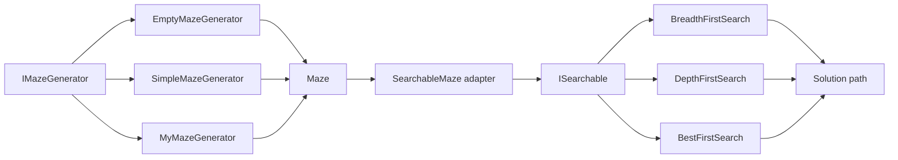

# Java Maze Generation & Search Algorithms

[](https://github.com/KulmanD/java-maze-algorithms/actions/workflows/ci.yml)
[](https://openjdk.org/)
[](https://maven.apache.org/)

A reusable Java library for generating two-dimensional mazes and solving them with multiple graph-search strategies. The project separates the search algorithm from the problem domain, so the same BFS, DFS, and cost-aware Best-First implementations can operate on any domain that implements `ISearchable`.

This repository is a portfolio-focused presentation of an academic algorithms and object-oriented programming project. It includes a conventional Maven layout, automated tests, a command-line demonstration, and continuous integration.

## Highlights

- Three interchangeable maze generators: empty, randomized simple, and a custom depth-first backtracking generator.
- Three search strategies behind one interface: Breadth-First Search, Depth-First Search, and heuristic-guided Best-First Search.
- An adapter that converts a grid-based `Maze` into a generic `ISearchable` state space.
- Orthogonal and diagonal movement, with weighted movement costs and corner-cutting prevention.
- Reusable state and solution abstractions with path reconstruction.
- JUnit 5 coverage and GitHub Actions validation.

## Architecture



The design keeps generation, domain adaptation, and traversal independent. New generators can implement `IMazeGenerator`; new problem domains can implement `ISearchable`; and new solvers can implement `ISearchingAlgorithm` without changing the existing components.

## Algorithms

| Component | Approach | Main data structures |
| --- | --- | --- |
| `EmptyMazeGenerator` | Produces an open grid for baseline testing | 2D integer array |
| `SimpleMazeGenerator` | Places random walls and retries until the endpoints remain connected | Queue, 2D visited array |
| `MyMazeGenerator` | Carves passages with randomized depth-first backtracking | Stack, lists |
| `BreadthFirstSearch` | Explores the state graph level by level | FIFO queue, hash set |
| `DepthFirstSearch` | Explores one branch at a time | LIFO deque, hash set |
| `BestFirstSearch` | Prioritizes accumulated movement cost plus a goal-distance heuristic | Priority queue, hash set |

Straight movement costs 10 and diagonal movement costs 15 in the cost-aware search. A diagonal transition is accepted only when its adjacent orthogonal cells are also open.

## Run locally

Prerequisites:

- JDK 15 or newer
- Apache Maven 3.8 or newer

Clone and verify the project:

```bash
git clone https://github.com/KulmanD/java-maze-algorithms.git
cd java-maze-algorithms
mvn verify
```

Run the command-line showcase with the default 15 x 31 maze:

```bash
mvn compile exec:java
```

Pass custom dimensions (minimum 3 x 3):

```bash
mvn compile exec:java -Dexec.args="25 45"
```

The demo prints the generated maze, then compares the number of evaluated nodes and solution-path length for each search algorithm. Maze generation is randomized, so output varies between runs.

## Project structure

```text
src/
├── main/java/
│   ├── algorithms/
│   │   ├── mazeGenerators/   # Maze model and generation hierarchy
│   │   └── search/           # Generic states, adapter, solvers, and solutions
│   └── demo/                 # Runnable command-line showcase
└── test/java/algorithms/     # Generator and search behavior tests
```

## Knowledge demonstrated

- Object-oriented design with interfaces, abstract classes, inheritance, encapsulation, and polymorphism.
- SOLID-oriented separation between algorithms and the domains they operate on.
- Adapter and Strategy-style design patterns.
- Graph traversal, heuristic search, path reconstruction, and movement-cost modeling.
- Java Collections including `Queue`, `Deque`, `Stack`, `PriorityQueue`, `List`, and `Set`.
- Defensive input validation, automated testing, Maven project organization, and CI workflows.

## Academic scope

The original coursework described a larger multi-stage maze system. The code available in this repository represents the maze-generation and search-library milestone only. Later networking, concurrency, compression, and JavaFX desktop milestones are intentionally not claimed here because their implementations were not part of the uploaded source set.

The original assignment PDF is not redistributed in this repository. It was used only to verify the intended terminology, package boundaries, and project scope.
